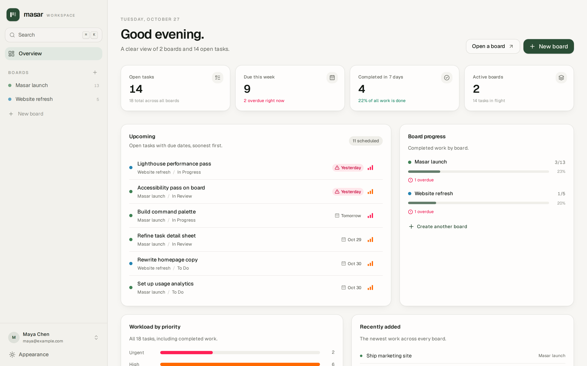
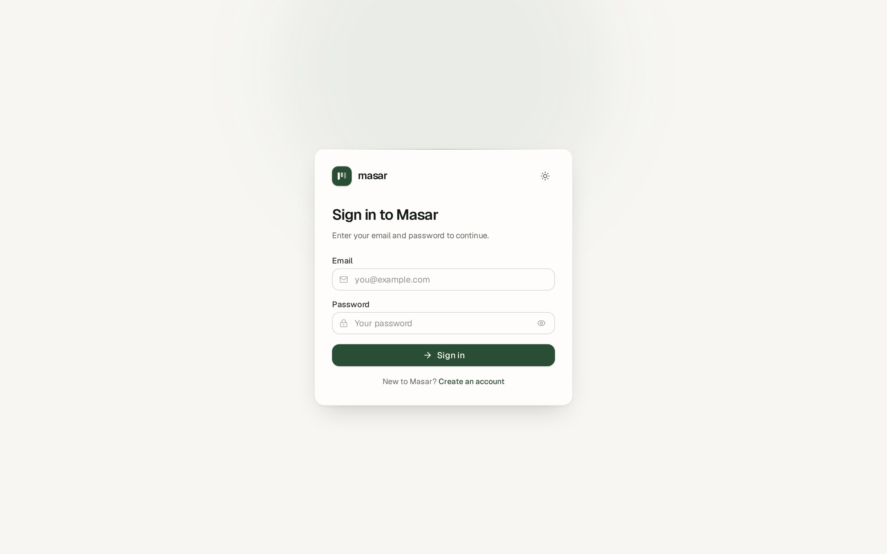
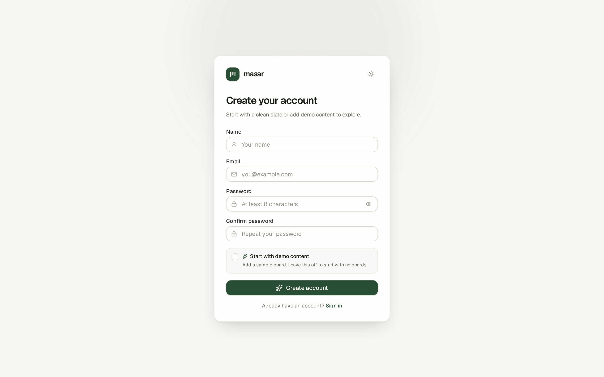
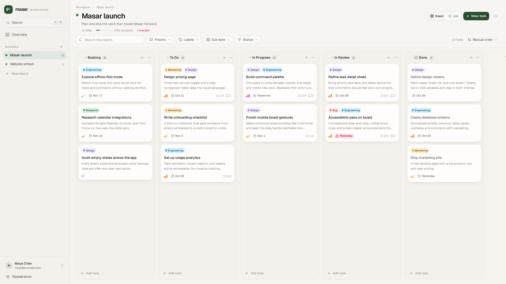
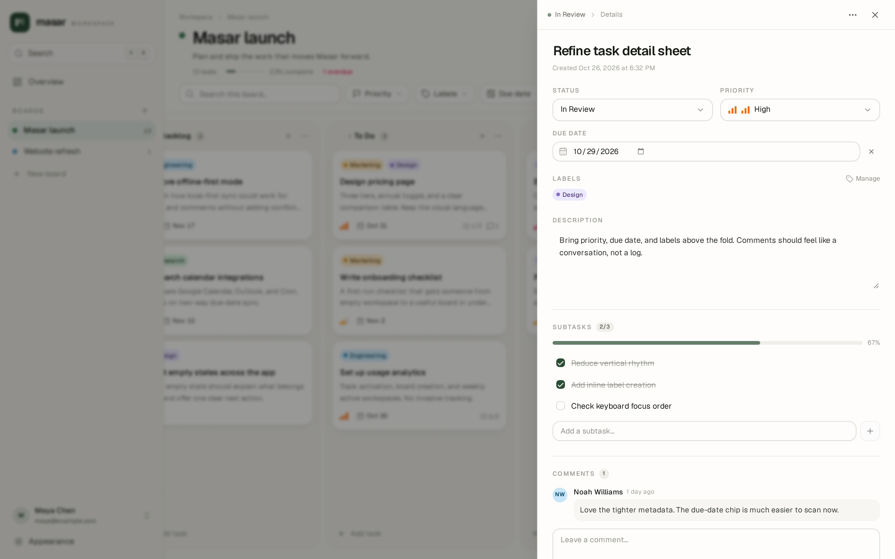
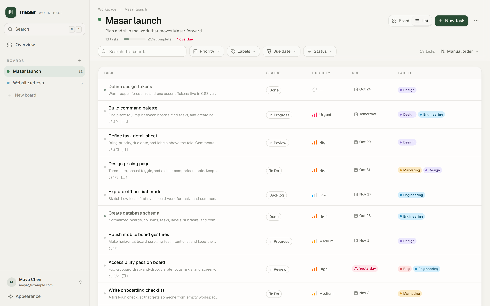
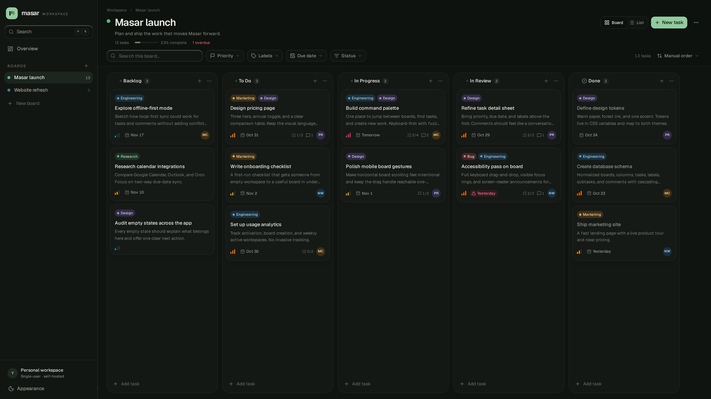

# Masar

Masar is a Kanban app for organizing projects. It has boards with ordered columns, tasks with labels, subtasks, comments, priorities, and due dates, plus a dashboard for upcoming work and progress.

Masar is the Arabic word for path, route, or course. The name reflects the app's main job: giving work a clear path from backlog to completion.

Every account has a private workspace. Accounts can sign up, sign in, sign out, and keep a persistent session. Boards, tasks, labels, subtasks, comments, search, and dashboard data are scoped to the signed-in account. There is no team sharing or cross-account access.

Built with Next.js, React, Tailwind CSS, Drizzle, SQLite/libSQL, Better Auth, dnd-kit, Zod, Vitest, and Playwright.



## Features

- Accounts: email/password sign-up and sign-in, persistent sessions, and sign-out from the sidebar.
- Private workspaces: every board and all of its child data belong to one account. Guessing another account's board, task, label, subtask, or comment ID returns a 404.
- Empty by default: a new account starts with no boards. Demo content is added only when the sign-up checkbox is selected.
- Boards and columns: create, rename, recolor, reorder, and delete them. Each board has one done column. Deleting a column moves its tasks to the first remaining column.
- Tasks: create inline or in a dialog, then edit the title, description, priority, due date, labels, subtasks, and comments. Duplicate or delete tasks when needed.
- Drag and drop: move tasks within or between columns with a pointer or keyboard. The order is saved. Reordering is disabled while filters or non-manual sorting are active.
- Views: switch between board and list views. The choice is saved in the browser.
- Search and filters: search the current board, filter by priority, label, due date, or status, and sort manually, by due date, priority, or newest. Cmd/Ctrl+K opens global search.
- Dashboard: open tasks, due this week, completed in the last seven days, active boards, upcoming work, priority breakdown, recent tasks, and board progress.
- Themes and layout: light, dark, and system themes, a responsive sidebar, mobile navigation, toasts, and confirmation dialogs.
- Data: SQLite locally, Turso when deployed, with migrations, foreign keys, indexes, and transactions.

## Screenshots

### Sign in



### Create account



### Board



### Task details



### List view



### Dark theme



## Running locally

You need Node.js 20.9 or newer and npm.

```bash
npm install
cp .env.example .env.local
# Add BETTER_AUTH_SECRET to .env.local:
#   openssl rand -base64 32
npm run db:migrate
npm run dev
```

Open [http://localhost:3000](http://localhost:3000) and create an account at `/signup`.

The app uses `./data/app.db` by default. `npm run dev` applies pending migrations before starting. A new account starts empty; select **Start with demo content** during sign-up to add the sample board.

To seed demo boards into an existing account, register that account first and run:

```bash
npm run db:seed -- --email you@example.com
```

`db:seed` skips an account that already has boards. Add `--force` to replace that account's boards with demo content. It never touches another account's data. To delete the local database and start over, run `npm run db:reset`.

### Environment variables

Local development needs a `BETTER_AUTH_SECRET` for stable sessions. Everything else has a local default.

| Variable | Purpose |
| --- | --- |
| `DATABASE_URL` | `file:./data/app.db` locally or a hosted `libsql://…` URL. Required on Vercel. |
| `TURSO_DATABASE_URL` | Alias for `DATABASE_URL`. |
| `TURSO_AUTH_TOKEN` | Auth token for a hosted Turso database. |
| `DATABASE_AUTH_TOKEN` | Alias for `TURSO_AUTH_TOKEN`. |
| `BETTER_AUTH_SECRET` | Signs session cookies. Generate with `openssl rand -base64 32`. Required in production. |
| `BETTER_AUTH_URL` | Public origin used by authentication, for example `https://masar.example.com`. |
| `ALLOW_LOCAL_DB_IN_PRODUCTION` | Suppresses the local-file warning in a non-Vercel production runtime. Don't set it on Vercel. |

Copy `.env.example` to `.env.local` if you need overrides. `.env.local` takes precedence over `.env`.

`src/db/config.ts` picks the database. On Vercel, the app needs `DATABASE_URL` and an auth token. If they are missing or point to a local file, it fails with a configuration error instead of writing to temporary storage. The production runtime throws if `BETTER_AUTH_SECRET` is missing; `next build` itself does not require it.

### Database commands

| Command | What it does |
| --- | --- |
| `npm run db:migrate` | Apply pending migrations. |
| `npm run db:seed -- --email you@example.com` | Add demo boards to that existing account if it has no boards. |
| `npm run db:seed -- --email you@example.com --force` | Replace that account's boards with demo content. |
| `npm run db:claim-workspace -- --email owner@example.com --dry-run` | Count pre-auth and unowned boards that would be assigned to that account. |
| `npm run db:claim-workspace -- --email owner@example.com --confirm` | Assign those boards to that account. |
| `npm run db:reset` | Delete the local database and re-run migrations. Never run against production. |
| `npm run db:generate` | Generate a migration after schema changes. |
| `npm run db:studio` | Open Drizzle Studio. |

## Migrating an existing single-user database

Migration `drizzle/0001_auth_and_workspace_ownership.sql` adds the auth tables, a nullable `boards.owner_id` foreign key, and an owner/position index. It also:

1. Creates a system account with the id `legacy-workspace` and email `legacy-workspace@masar.invalid`. It has no password, account, or session, so nobody can sign in as it.
2. Assigns every existing board to that system account.
3. Leaves `owner_id` nullable so the old single-user app keeps working if it writes during the migration-first rollout.

New application code never reads boards whose `owner_id` is `NULL` or `legacy-workspace`. Those rows are therefore invisible to every registrant until an operator explicitly claims them. A board inserted by the old app after the migration also receives `NULL` and is handled the same way.

The claim command is deliberately explicit and requires a confirmation flag:

```bash
npm run db:claim-workspace -- --email owner@example.com --dry-run
npm run db:claim-workspace -- --email owner@example.com --confirm
```

The account must already exist. `--dry-run` only counts boards; `--confirm` moves all `legacy-workspace` and `NULL`-owned boards to that account and removes the system account. It does not touch boards owned by other accounts, and it does not change task, label, subtask, or comment content. If you never claim the old data, it stays orphaned and inaccessible to registrants.

> **Warning:** The claim is the only step that decides who receives the old single-user data. Do not run `--confirm` until the intended owner has registered. Never hand the legacy workspace to the first person who happens to sign up.

## Deploying

Masar needs a hosted Turso/libSQL database when it is deployed. These steps use Vercel, but the same environment variables work on other Node hosts.

1. Create a Turso database and token:

   ```bash
   turso db create masar
   turso db show masar --url
   turso db tokens create masar
   ```

2. Generate an auth secret:

   ```bash
   openssl rand -base64 32
   ```

3. Add the environment variables to the Production (and Preview) environment in your host:

   - `DATABASE_URL` — the `libsql://…` URL
   - `TURSO_AUTH_TOKEN` — the database token
   - `BETTER_AUTH_SECRET` — the generated secret
   - `BETTER_AUTH_URL` — the public URL of the app

4. Back up the production database before changing anything.

5. **Run the migration while the old app is still deployed.** This is safe because the new owner column is nullable and existing rows are preserved:

   ```bash
   DATABASE_URL="libsql://masar-<org>.turso.io" \
   TURSO_AUTH_TOKEN="<token>" \
   npm run db:migrate
   ```

   The old app remains usable immediately after this step. It does not know about the new column, so any board it creates during the rollout stays unowned.

6. Deploy the new application code. Do not reverse steps 5 and 6: the new code expects the auth tables and `owner_id` to exist.

7. Register the account that should own the pre-auth workspace, for example `owner@example.com`. Other accounts can register too; the claim only targets the email you pass explicitly.

8. Claim the old workspace against that account:

   ```bash
   DATABASE_URL="libsql://masar-<org>.turso.io" \
   TURSO_AUTH_TOKEN="<token>" \
   npm run db:claim-workspace -- --email owner@example.com --dry-run
   ```

   If the count looks right, repeat with `--confirm`:

   ```bash
   DATABASE_URL="libsql://masar-<org>.turso.io" \
   TURSO_AUTH_TOKEN="<token>" \
   npm run db:claim-workspace -- --email owner@example.com --confirm
   ```

9. Check `/api/health`, sign in as the intended owner, and verify boards, tasks, labels, subtasks, and comments survived the migration.

Migrations do not run during `next build`. Apply them as a separate deploy or CI step, in the order above. `npm run db:reset` and destructive seeds are local-only tools; never run them against production.

## Tests

```bash
npm run lint
npm run typecheck
npm test
npx playwright install chromium
npm run test:e2e
npm run verify
```

Vitest uses a temporary SQLite database, so tests don't touch `data/app.db`. The suite covers the migration from the old schema, preservation and claiming of legacy rows, owner-scoped server operations, and cross-account isolation. Playwright uses `data/e2e.db`, starts the dev server on port 3100 with a test auth secret, and covers sign-up, sign-in, sign-out, empty workspaces, demo opt-in, account isolation, and the main board workflows. `npm run verify` runs lint, typecheck, tests, and a build.

## License

Private project. All rights reserved.
