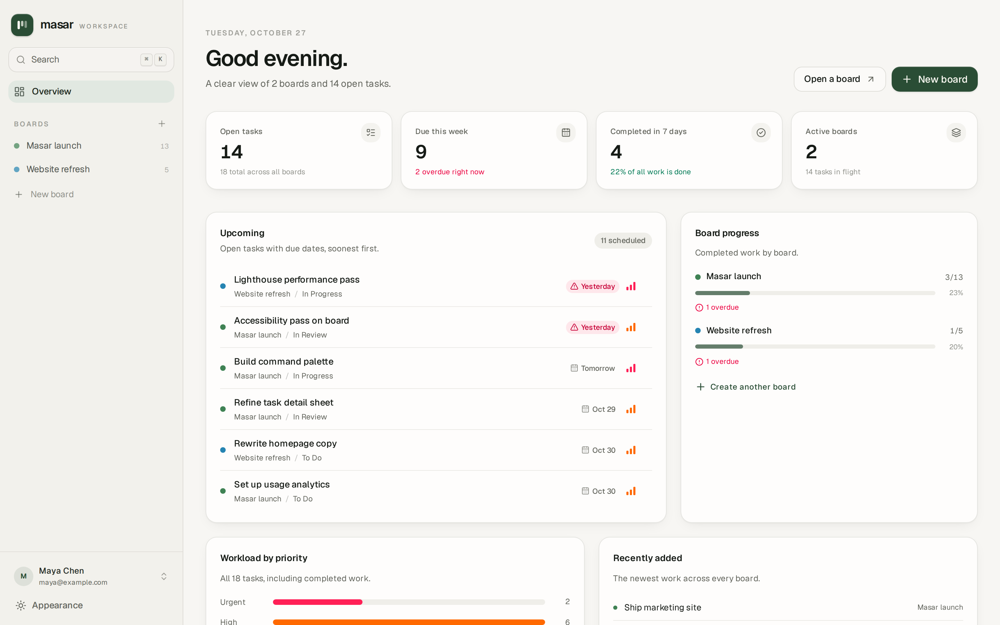

# Masar

Masar is a project management app for organising projects, managing tasks and tracking progress. Create boards, organise columns, set priorities and due dates, manage subtasks and comments, and monitor upcoming work from your dashboard.

## Get Masar

Masar is a desktop application for macOS, Windows and Linux. Download the build for your platform from GitHub [Releases](https://github.com/aartan/masar/releases):

- macOS: Apple Silicon or Intel.
- Windows: x64 installer.
- Linux: rpm or AppImage for x64 and arm64.

## Features

- Boards and columns: Create, customise, reorder and organise project boards.
- Task management: Track descriptions, priorities, due dates, labels, subtasks and comments.
- Drag and drop: Move and reorder tasks and columns using a mouse or keyboard.
- Board and list views: Switch views, search tasks, apply filters and sort results.
- Dashboard: Review open tasks, upcoming deadlines, recent activity and project progress.
- Private local workspace: Work without an account; your boards and tasks are stored locally in SQLite.
- Themes and responsive layouts: Light, dark and system themes with a responsive desktop interface.
- Offline desktop use: Work locally on macOS, Windows or Linux for free, with optional online sync through a subscription.

## Subscriptions & billing

Online sync runs on hosted infrastructure and requires a subscription to help cover server costs. Offline use through the desktop app is free.

## Technology

Built with Electron, Vite, React, React Router, Tailwind CSS, Hono, Drizzle ORM, SQLite (libSQL), dnd-kit, Zod, Vitest and Playwright.
