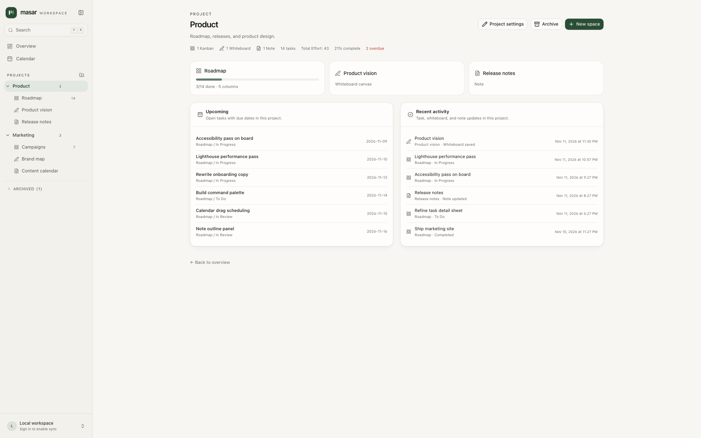
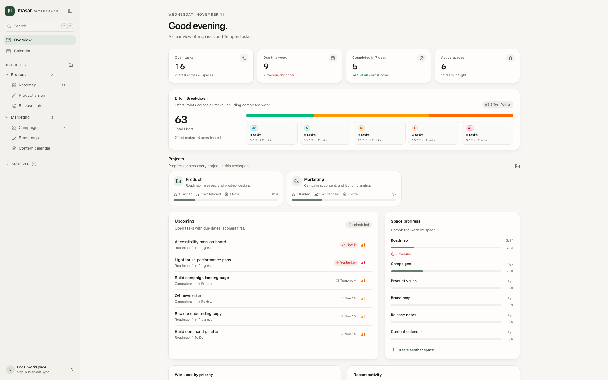
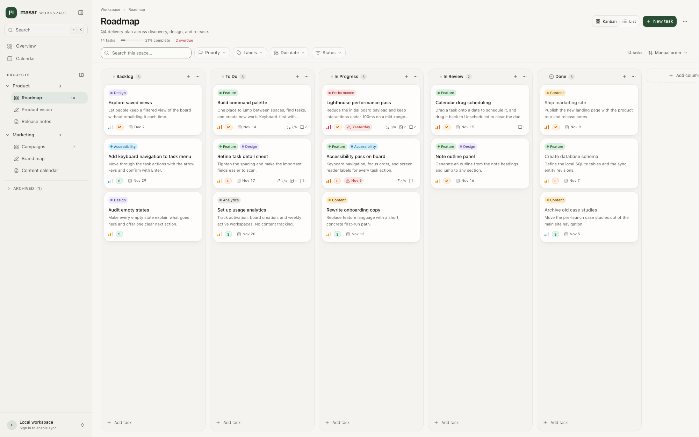
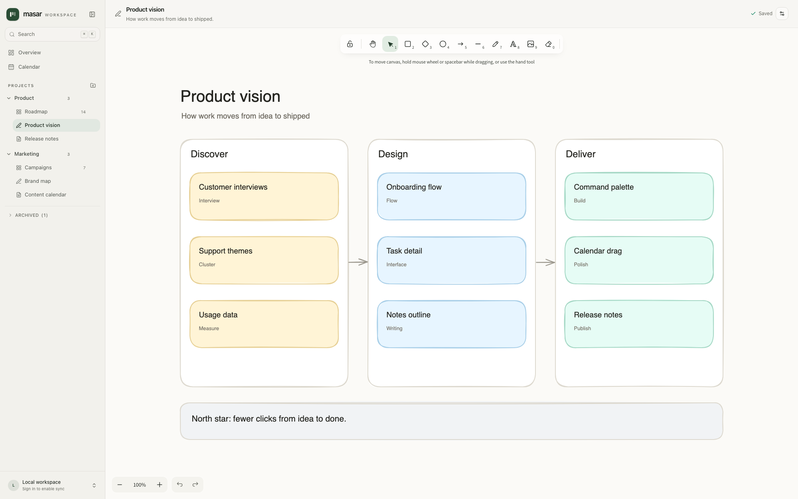
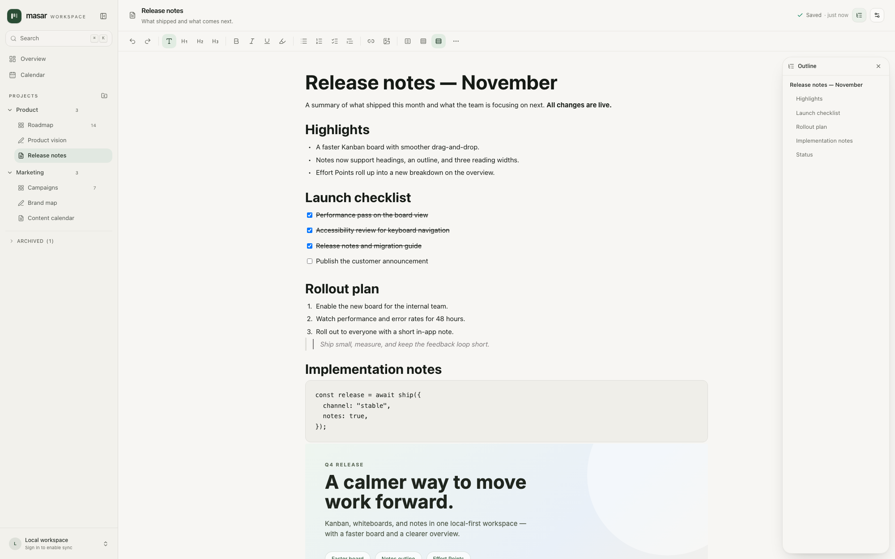
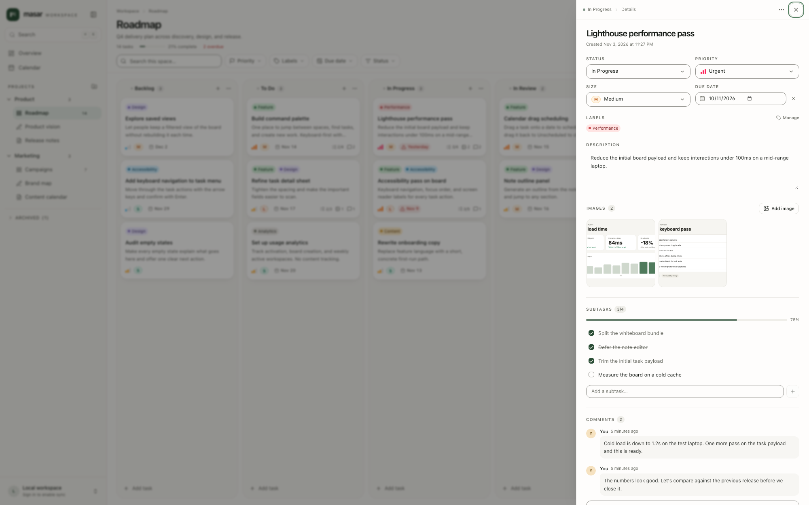
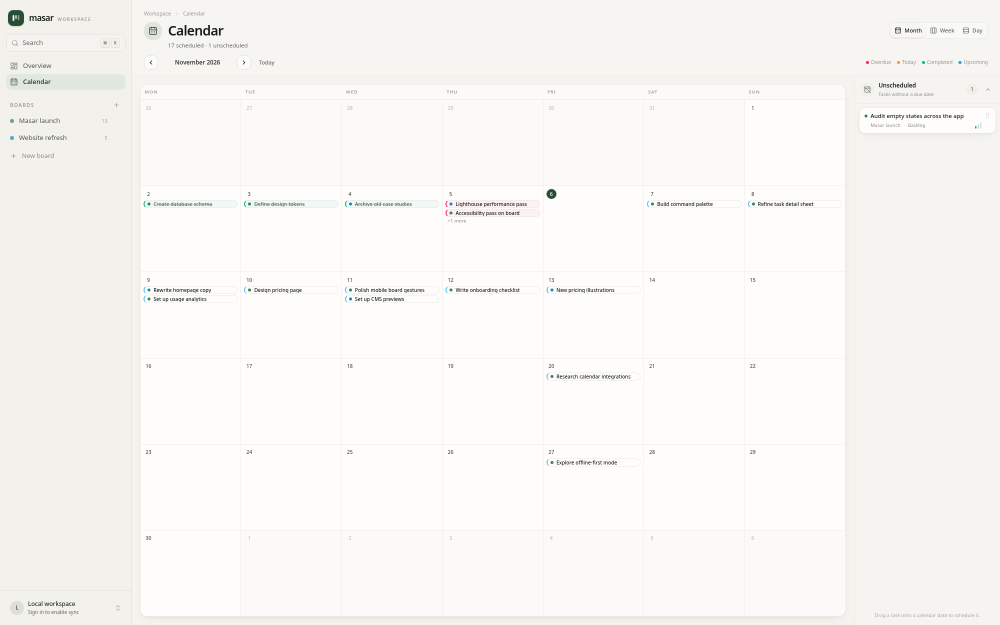

# Masar

Masar is a project management app for organising work across projects and spaces. Group related work into projects, choose a Kanban space, a whiteboard, or a note for each space, and keep tasks, due dates, and progress in one place.

## Projects and spaces

Work is organised as **Workspace → Projects → Spaces → Tasks**. Each project can hold any mix of three space types:

- **Kanban spaces** for task-based work with columns and task cards.
- **Whiteboards** for free-form diagrams, sketches, and brainstorms.
- **Notes** for rich-text documents such as meeting notes, specs, and research.

Spaces have a name, an optional description, and a distinct icon per type. Reorder projects, reorder spaces within a project, and drag spaces between projects. Each project has its own overview with its spaces, completion progress, upcoming tasks, and recent activity.

## Overview dashboard

The workspace overview brings everything together:

- **Key metrics** — open tasks, work due this week, overdue tasks, completions in the last seven days, and active spaces.
- **Effort Breakdown** — total points across all tasks, estimated vs unestimated work, and the distribution across XS, S, M, L, and XL sizes.
- **Projects** — a card for each project with its Kanban, whiteboard, and note counts plus task progress.
- **Upcoming** — open tasks with due dates, soonest first.
- **Space progress** — completion percentage and overdue counts for each space.
- **Workload by priority** — task counts across urgent, high, medium, low, and no priority.
- **Recent activity** — recent task, whiteboard, and note updates across projects.

## Kanban spaces

Kanban spaces start with five columns and can be shaped to fit your workflow: add, rename, reorder, or delete columns, and mark the columns that count as done. Drag tasks between columns and reorder them within a column.

Switch between the board and list views from the toolbar. Both support the same filters — priority, labels, due date, and status — and sorting by manual order, due date, priority, or newest. Create tasks inline, and use the task menu to duplicate, move, or delete them.

## Whiteboards

Whiteboards are free-form infinite canvases for diagrams, sketches, and brainstorms. Draw, add shapes and text, and arrange ideas spatially. Changes save automatically with a visible save status, and whiteboards remain available offline. In the premium synced workspace, images are stored in the cloud; the free local workspace keeps them embedded so it stays offline-first.

## Notes

Notes are rich-text spaces for meeting notes, specs, research, and longer-form writing. Format text with headings, bold, italic, underline, strikethrough, highlights, and inline code. Add bulleted, numbered, and checklist lists, quotes, code blocks, tables, links, images, and dividers.

A heading outline lets you jump around long documents, and the reading width can be set to narrow, standard, or wide. Notes save automatically, show their save status, and remain available offline. In the premium synced workspace, note images are stored in the cloud; the free local workspace keeps them embedded.

## Tasks

Open any task to edit its title and description, change its status, priority, effort, due date, and labels, and attach images.

Break work into subtasks, discuss it in comments, and duplicate or delete the task when plans change. Tasks can have up to 20 images, added by file picker or drag-and-drop, with preview and download.

## Calendar

Plan scheduled work in month, week, and day views. Drag tasks onto a date to schedule them, or move them back to the Unscheduled panel to clear the due date. Open any task from the calendar to see or edit its details.

## Search and shortcuts

Press `Cmd/Ctrl+K` to search tasks and spaces and jump straight to them. Press `N` on a Kanban space to create a task and `?` to open the shortcut guide.

| Shortcut | Action |
| --- | --- |
| `Cmd/Ctrl+K` | Search tasks and spaces |
| `N` | Create a task on the current Kanban space |
| `?` | Show the shortcut guide |
| `Space` | Pick up a task with its drag handle |
| `Esc` | Close a panel or dialog |
| `Tab` | Move through controls and fields |

## Get Masar

Masar is distributed as a desktop application. Download the latest build for your platform from GitHub [Releases](https://github.com/aartan/masar/releases):

- macOS: `.dmg` for Apple Silicon or Intel.
- Windows: `.exe` installer for x64.
- Linux: `.rpm`, `.deb` or `.AppImage` for x64 and arm64.

## Cloud sync

The local workspace is free and does not require an account. Cloud sync runs on hosted infrastructure and requires an active subscription.

## Technology

Built with Electron, React, Vite, Tailwind CSS, Hono, Drizzle ORM, and SQLite (libSQL).
